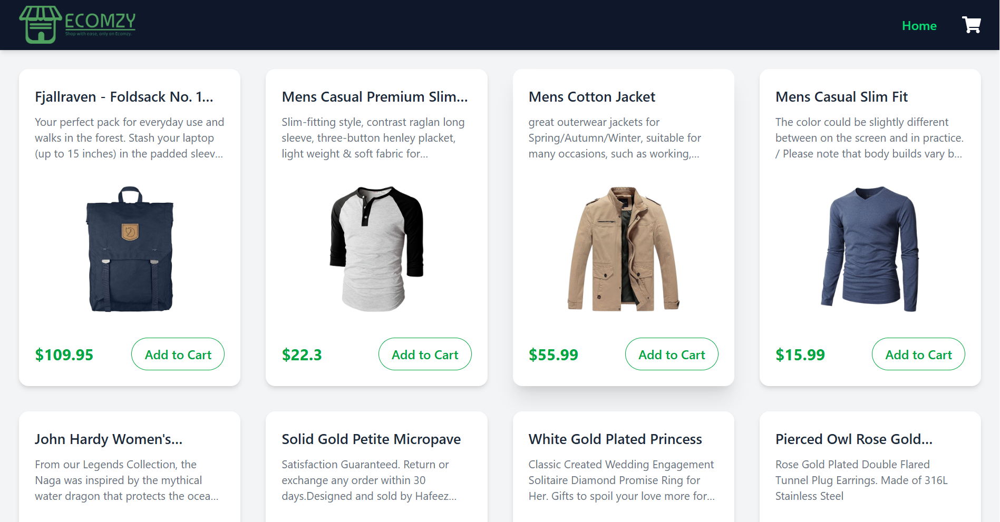
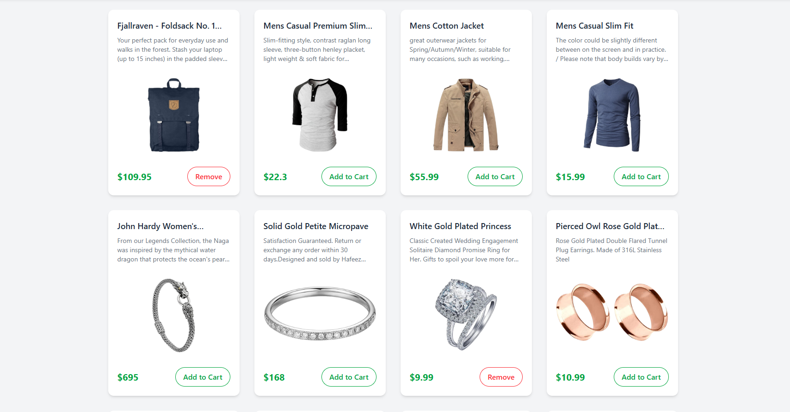
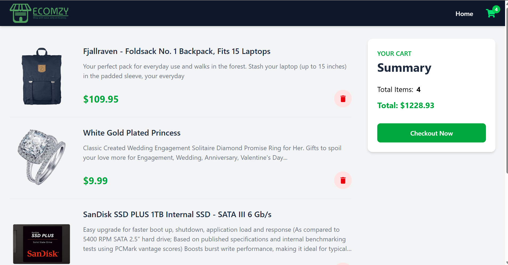
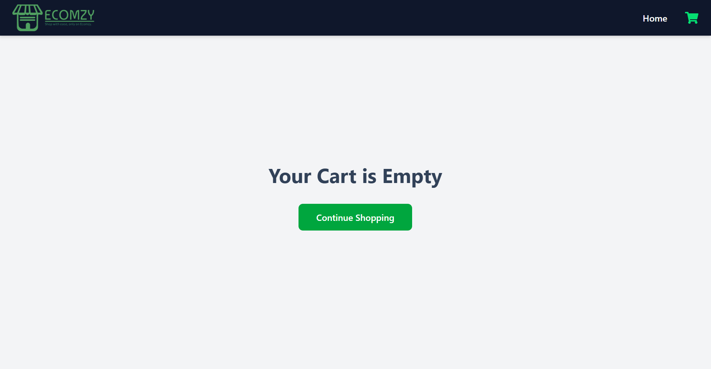

# 🛒 Shopping Cart

A responsive **Shopping Cart** application built using **React**, **Redux Toolkit**, **Tailwind CSS**, and **Fake Store API**. Users can browse products, add or remove items from the cart, view the total amount, and enjoy a clean, responsive shopping experience.

---

## 🚀 Live Demo

🔗 **Live Website:** https://shopping-cart-psi-rosy.vercel.app/

---

## 📂 GitHub Repository

🔗 **Repository:** https://github.com/Arsh173/shopping-cart

---

## ✨ Features

- 🛍️ Browse products from the Fake Store API
- ➕ Add products to the shopping cart
- ➖ Remove products from the shopping cart
- 🛒 Dynamic cart item counter in the navbar
- 💰 Automatic total price calculation
- 🔔 Toast notifications for cart actions
- ⚡ Fast and responsive user interface
- 📱 Mobile-friendly design
- 🔄 Global state management using Redux Toolkit

---

## 🛠️ Tech Stack

- React
- Redux Toolkit
- React Router DOM
- Tailwind CSS
- Vite
- Fake Store API
- React Hot Toast
- React Icons

---

## 📸 Screenshots

### 🏠 Home Page



---

### 🛍️ Products Grid



---

### 🛒 Shopping Cart



---

### 📦 Empty Cart



---

## 📁 Project Structure

```text
shopping-cart
│── public
│── screenshots
│   ├── home.png
│   ├── products.png
│   ├── cart.png
│   └── empty-cart.png
│── src
│   ├── components
│   ├── pages
│   ├── redux
│   ├── App.jsx
│   ├── main.jsx
│   └── index.css
│── package.json
│── vite.config.js
└── README.md
```

---

## ⚙️ Installation

### Clone the repository

```bash
git clone https://github.com/Arsh173/shopping-cart.git
```

### Navigate to the project folder

```bash
cd shopping-cart
```

### Install dependencies

```bash
npm install
```

### Start the development server

```bash
npm run dev
```

---

## 🎯 Learning Outcomes

Through this project, I gained hands-on experience with:

- Building reusable React components
- React Hooks (`useState`, `useEffect`)
- React Router for navigation
- Redux Toolkit for global state management
- Fetch API for data fetching
- Tailwind CSS for responsive UI design
- Managing application state efficiently
- Component-based architecture
- Git & GitHub workflow
- Deploying React applications with Vercel

---

## 🔮 Future Improvements

- 🔍 Product Search
- 🏷️ Product Categories
- 🎛️ Product Filtering
- ❤️ Wishlist Feature
- ➕ Product Quantity Management
- 🌙 Dark Mode
- 💳 Checkout Process
- 🔐 User Authentication

---

## 👨‍💻 Author

**Arsh**

- **GitHub:** https://github.com/Arsh173
- **LinkedIn:** https://www.linkedin.com/in/arsh0786/

---

## ⭐ Support

If you found this project useful, consider giving it a **⭐ Star** on GitHub.